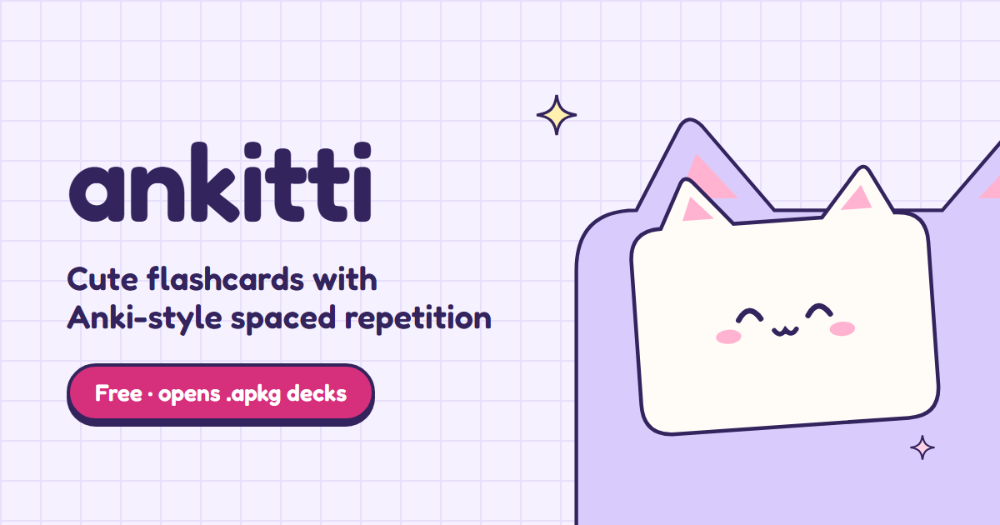

<div align="center">



# 🎀 Ankitti (あんキティ)

### *Spaced Repetition Flashcards • Master Anything with Kawaii Magic*

[](LICENSE)
[](https://react.dev/)
[](https://www.typescriptlang.org/)
[](https://vitejs.dev/)
[](https://tailwindcss.com/)
[](https://workers.cloudflare.com/)

**Ankitti** is an open-source, mobile-first spaced repetition study application blending the mathematical rigor of Anki's SM-2 algorithm with a delightful retro Sanrio / Hello Kitty aesthetic and Apple iOS glassmorphism.

[Features](#-features) • [Quick Start](#-quick-start) • [Deployment](#-deployment-to-cloudflare) • [Tech Stack](#-tech-stack) • [Contributing](#-contributing) • [License](#-license)

</div>

---

## ✨ Features

- **🌸 Kawaii Hello Kitty × Apple iOS Aesthetic**
  - Tactile bouncy buttons, pastel cards, glassmorphic bottom sheets, subtle cherry blossom petals, and cheerful study companions.
  - Responsive layout optimized for phones, iPads, and desktop screens with native bottom navigation.

- **🧠 SM-2 Spaced Repetition Engine**
  - Scientifically proven algorithm calculating ease factors, intervals, repetition steps, and lapses for optimal long-term memory retention.
  - Same-day review mode to keep practicing whenever you want without artificial lockouts.

- **🤖 AI Flashcard Deck Generator**
  - Generate complete high-yield flashcard decks from any topic or raw lecture notes in seconds using DeepSeek AI.
  - Automatically produces mnemonics, high-yield clinical/key takeaways, and contextual tags.

- **📸 Image & Screenshot Paste Attachments**
  - Paste directly from your clipboard (`Ctrl+V` / `Cmd+V`) onto the front or back of any card.
  - Interactive full-screen zoomable lightbox for diagrams, histology slides, equations, and visual study aids.

- **📦 Anki `.apkg` Importer & JSON Export**
  - Seamlessly import existing Anki decks with full tags, fields, and cloze deletions (`{{c1::answer}}`).
  - Export your collection anytime with zero vendor lock-in.

- **⏱️ Integrated Pomodoro Focus Widget**
  - Kawaii study timer (25/5 intervals) with custom chimes and study streak tracker.

- **🔐 Cloudflare D1 & SQLite Database Isolation**
  - Multi-user authentication with salted PBKDF2 password hashing and secure session tokens.
  - Works out of the box locally via Node 22 native `node:sqlite` or at the edge with Cloudflare D1.

---

## 🚀 Quick Start

### Prerequisites
- [Node.js](https://nodejs.org/) v20+ (Node 22 recommended)
- npm or pnpm

### 1. Clone the Repository
```bash
git clone https://github.com/Astidor/ankitti.git
cd ankitti
```

### 2. Install Dependencies
```bash
npm install
```

### 3. Configure Environment Variables
Copy `.env.example` to `.env`:
```bash
cp .env.example .env
```
*(Optional)* Add your DeepSeek API key for AI deck generation:
```ini
DEEPSEEK_API_KEY="your-deepseek-api-key-here"
```

### 4. Run Development Server
```bash
npm run dev
```
Open **[http://localhost:5173](http://localhost:5173)**. Both the Vite client and backend API middleware will run concurrently!

---

## ☁️ Deployment to Cloudflare

Ankitti is designed for zero-config deployment on **Cloudflare Workers & Static Assets** or **Cloudflare Pages**.

### 1. Create Cloudflare D1 Database
In the Cloudflare dashboard (or via Wrangler CLI):
```bash
npx wrangler d1 create ankitti-db
```
Copy the generated `database_id` into [`wrangler.toml`](wrangler.toml):
```toml
[[d1_databases]]
binding = "DB"
database_id = "<your-d1-database-id>"
```

### 2. Initialize the Database Schema
In your Cloudflare dashboard (**Storage & Databases** → **D1** → **Console**), run the contents of [`schema.sql`](schema.sql), or via CLI:
```bash
npx wrangler d1 execute ankitti-db --file=./schema.sql --remote
```

### 3. Deploy
```bash
npm run build
npx wrangler deploy
```

---

## 🛠️ Tech Stack

| Layer | Technology |
|---|---|
| **Frontend** | React 19, TypeScript, Tailwind CSS, Lucide Icons, Canvas Confetti |
| **Edge & Server** | Cloudflare Workers, Pages Functions, Express.js middleware |
| **Database** | Cloudflare D1 (Edge SQLite) / Node.js native `node:sqlite` |
| **AI Integration** | DeepSeek API (`deepseek-chat`) |
| **Build & Tooling** | Vite, PostCSS, Oxlint, Wrangler |

---

## 🤝 Contributing

Contributions make the open-source community an amazing place to learn, inspire, and create! Any contributions to Ankitti are **greatly appreciated**.

1. Fork the Project
2. Create your Feature Branch (`git checkout -b feature/AmazingFeature`)
3. Commit your Changes (`git commit -m 'feat: add some amazing feature'`)
4. Push to the Branch (`git push origin feature/AmazingFeature`)
5. Open a Pull Request

---

## 📄 License

Distributed under the **MIT License**. See [`LICENSE`](LICENSE) for more information.

---

<div align="center">
  Crafted with 🎀 and 💖 for students, lifelong learners, and memory champions everywhere.
</div>
